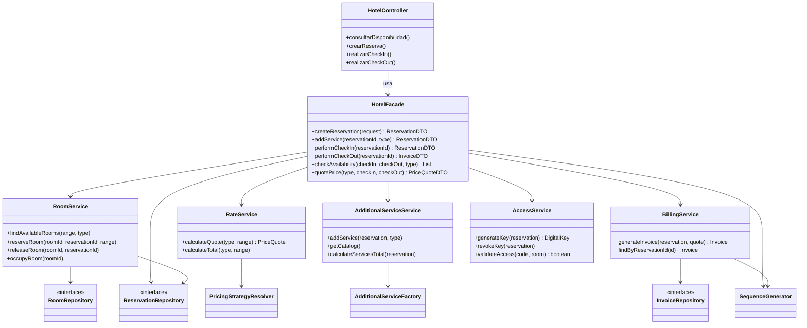

# Arquitectura

El backend es una API REST en Spring Boot 4 (Java 17) organizada en capas. El estado se mantiene en memoria mediante colecciones concurrentes, sin base de datos ni JPA.

Paquete raíz: `com.hotel.reservations`.

## Capas

| Capa | Paquetes | Responsabilidad |
|---|---|---|
| Presentación | `controller`, `dto`, `mapper` | Recibe HTTP, valida entrada y convierte modelo <-> DTO. |
| Fachada | `facade` | Coordina los subsistemas para cada caso de uso. |
| Servicios | `service` | Lógica de cada subsistema (habitaciones, tarifas, servicios, facturación, acceso). |
| Dominio | `model`, `model.service` | Entidades, enums y reglas internas (por ejemplo, transiciones de estado). |
| Infraestructura | `repository`, `util`, `config`, `pricing`, `factory` | Almacenamiento en memoria, secuencias de IDs, configuración, estrategias y fábricas. |
| Errores | `exception` | Excepciones de dominio con código HTTP y manejo global. |

## Diagrama de clases: fachada y subsistemas

Nota: la fachada y el controlador aparecen según la especificación de diseño. En la rama actual del código todavía no existen `HotelFacade` ni `HotelController`; el diagrama describe la arquitectura objetivo.

## Flujo de una reserva

1. El controlador recibe `POST /api/hotel/reservar` y delega en `HotelFacade.createReservation`.
2. La fachada valida el rango de fechas y consulta `RoomService` para reservar la habitación.
3. `RateService` calcula el precio noche a noche usando las estrategias de temporada.
4. La reserva se guarda en `ReservationRepository` y se devuelve como `ReservationDTO`.
